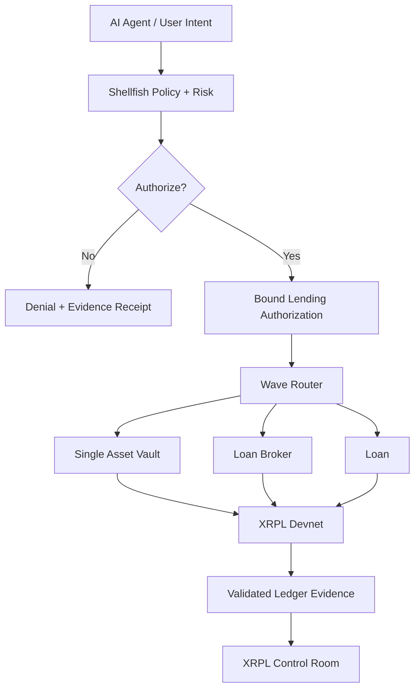
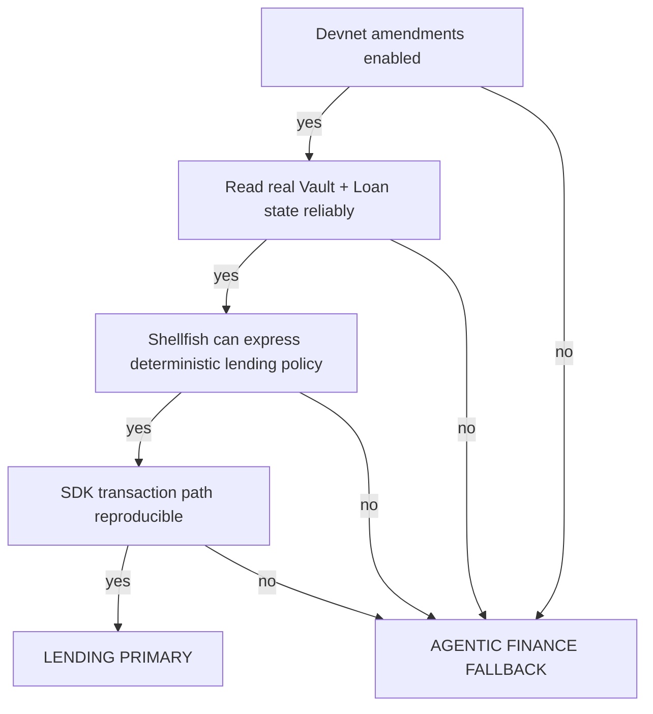

# XRPL Hackathon Track Evaluation — Agentic Finance vs Lending & Borrowing

Date: 2026-10-15
Status: pre-hackathon research and preparation only
Primary question: should the existing Shellfish + Wave Router + Control Room platform enter Agentic Finance or Lending & Borrowing?

## Current recommendation
Keep Agentic Finance as the low-risk fallback, but continue validating Lending & Borrowing as the higher-upside primary direction.

The platform remains broader than lending:
- Shellfish = policy, authorization, bounded agent authority, replay/tamper controls, evidence.
- Wave Router = XRPL routing, transaction boundary, path/invariant checks, execution-grant binding.
- XRPL Control Room = operator UI, wallet/payment/DEX/agent/safety/receipt/network visibility.

The proposed hackathon-specific lending feature is an **agentic risk and execution control layer for XRPL Lending Protocol**, not a claim that every existing Control Room feature is a lending feature.

## Visual architecture

## Why Lending is strategically interesting
XRPL native lending deliberately separates on-ledger loan/vault state from off-ledger underwriting and risk management. That creates a natural role for Shellfish: deterministic risk constraints, permissions, authorization, evidence and bounded agent behavior.

Possible policy checks:
- vault allowlist
- network
- vault lifecycle phase
- credential / permission-domain state
- maximum exposure
- borrower concentration limit
- loan term
- minimum acceptable rate
- authorization expiry
- replay / nonce state
- transaction type
- route / ledger-state binding

## Track comparison
| Factor | Agentic Finance | Lending & Borrowing |
|---|---:|---:|
| Existing-platform fit | 5/5 | 5/5 |
| 36-hour implementation risk | Lower | Higher |
| Judge demo clarity | Very high | High |
| XRPL-specific novelty | High | Very high |
| Uses newest XRPL primitives | Medium | Very high |
| Differentiation | Medium-high | High |
| Probability of polished finish | Highest | Medium-high |
| Upside if execution is clean | High | Very high |

Working strategy: **platform = agentic finance; judged module = lending**, with Agentic Finance retained as fallback if lending primitives or tooling become unreliable.

## Live Devnet verification — 2026-10-15
Endpoint checked: `wss://s.devnet.rippletest.net:51233`

Observed live state:
- network_id = 2
- xrpld build = 3.4.1
- validated ledger observed during check = 6144366

Feature RPC results:
- `SingleAssetVault` — enabled=true, supported=true
- `LendingProtocol` — enabled=true, supported=true
- `LendingProtocolV1_1` — enabled=true, supported=true
- `PermissionDelegationV1_1` — enabled=true, supported=true
- `PermissionedDEX` — enabled=true, supported=true
- `BatchV1_1` — enabled=true, supported=true

This is a strong go-signal for continued lending prototyping on Devnet. It is **not** evidence of Mainnet activation and must not be presented that way.

## Devnet wallets prepared
The existing disposable Testnet keypairs were funded on Devnet as well, avoiding creation of additional secrets.

- Agent wallet: `rsgX3HseicYBXP49jBtAh1gjpZKd22y69F`
- Approved destination / second sandbox wallet: `rhpaEH4cG3RVTp7Gj6yKNpL7fk47tqJyWy`
- Both observed with 100 Devnet XRP after faucet funding.
- Seeds were not printed.
- Existing local `.env` remains ignored by Git.

Important: these are disposable test credentials only. No Mainnet wallet or real funds are involved.

## SDK/tooling readiness
Wave Router currently resolves `xrpl` 4.6.0 locally even though package.json uses a `^4.3.0` range. The installed SDK bundle already contains lending/vault transaction model support including `VaultCreate`, `LoanSet`, `LoanBrokerSet`, and `LoanPay` symbols. Do not rely on this fact alone; event-day compatibility and exact xrpl.js version must be rechecked before judged implementation.

## Existing test baseline relevant to this decision
Wave Router current verification on 2026-10-15:
- TypeScript typecheck: PASS
- tests: 84/84 PASS
- build: PASS

Those tests already cover route/receipt binding, signed-grant tamper rejection, replay protection, read-only XRPL calls, path invariants, Testnet/Devnet boundaries, unsigned Payment drafts, transaction authorization mismatch rejection, and Mainnet denial.

Control Room current verification on 2026-10-15:
- TypeScript typecheck: PASS
- production build: PASS
- build produced non-fatal chunk-size warnings and Recharts circular-chunk warnings worth cleaning up before travel.

## Existing Control Room surfaces that can be tested now
These are pre-existing capabilities and can be hardened before the event:
- wallet/account read flows
- secure payment-agent parsing
- spending limits
- whitelist behavior
- cooldowns and expiry
- Xaman/manual signing UI behavior
- XRPL DEX/pathfinding
- route and slippage handling
- safety kernel / guardrails
- agent runtime/orchestration
- receipts/provenance
- ILP/micropayment views
- NFT tooling
- network / amendment / ledger telemetry
- red-team harness

Do not misrepresent all of these as lending-specific. They are reusable platform capabilities.

## Proposed judge demo if Lending is selected
### Allowed case
User/agent intent: deploy a bounded amount into an approved lending vault.

Expected visible path:
`Intent -> Ledger/Vault State -> Shellfish Risk Policy -> Bound Authorization -> Wave Router -> XRPL Lending Primitive -> Validated Ledger -> Proof Receipt`

### Denied case
Change one parameter:
- unapproved vault,
- exposure above ceiling,
- invalid credential,
- expired authorization,
- wrong lifecycle phase,
- tampered amount/transaction.

Expected result:
- signing blocked
- no submission
- deterministic denial reason
- evidence/receipt shown in Control Room

### Lifecycle-aware case
Closed-ended vault phases:
- Subscription: deposits allowed; new loans not yet allowed.
- Investment: deposits/withdrawals blocked; new loans can be originated.
- Redemption: no new loans; withdrawals permitted.

Shellfish should eventually consume the actual ledger state rather than infer the phase from UI state.

## Hackathon boundary
Safe now:
- live feature/amendment inspection
- Devnet connectivity and disposable wallet funding
- read-only vault/loan-state exploration
- official-doc research
- test fixtures
- test matrices
- failure cases
- UI wireframe / Mission Control shell
- baseline documentation
- environment/startup/preflight scripts
- existing-feature regression testing

Reserve for the official 36-hour judged window unless organizers explicitly say otherwise:
- new autonomous lending execution behavior
- final Shellfish lending authorization -> signer bridge
- judged Vault/Loan transaction executor
- event-specific validated execution receipt
- event-specific end-to-end lending demo logic

## Go / No-Go decision gates

Current state:
- Gate A: PASS
- Gate B: NEXT
- Gate C: architecture fit appears strong; implementation intentionally not started
- Gate D: SDK symbols exist locally; real transaction flow not yet exercised as judged feature

## Immediate pre-event tasks
1. Read live Devnet vault/loan ledger objects and confirm response shapes.
2. Create a non-executing lending fixture set for Subscription / Investment / Redemption.
3. Map ledger fields to Shellfish policy inputs.
4. Add Control Room test matrix for lending-state display and denial explanations.
5. Expand automated Control Room tests for existing payment/wallet/guardrail behavior.
6. Clean current build warnings that could create demo instability.
7. Freeze final pre-event SHAs and disclosure before travel.
8. Keep event-specific execution implementation behind the official start line.

## Official XRPL references
- Single Asset Vault concept: https://xrpl.org/docs/concepts/tokens/single-asset-vaults
- Create a Single Asset Vault: https://xrpl.org/docs/tutorials/defi/lending/use-single-asset-vaults/create-a-single-asset-vault
- VaultCreate transaction: https://xrpl.org/docs/references/protocol/transactions/types/vaultcreate
- Transaction types / lending transactions: https://xrpl.org/docs/references/protocol/transactions/types

## Current conclusion
**Lending is technically viable enough to keep as the high-upside primary candidate.** The strongest framing is not "AI makes a loan". It is: **an agentic risk-and-authority layer that lets AI interact with XRPL-native lending without giving the model unrestricted financial authority.**

Agentic Finance remains the safer fallback and shares nearly all of the same underlying infrastructure, so this evaluation does not create a dead-end branch.